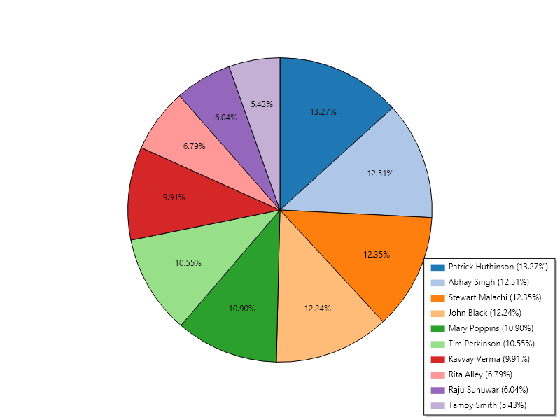

# Employee Time Report – C# Assignment

(1–2 lines: what the program does)

## How to run
(Where the exe is, double-click it, where the Output folder appears)

## Output

(Mention the HTML file and that rows under 100 hours are highlighted)

## How it works
(Your 4 services in one line each: API, Calculator, HTML, Pie chart)

## Data handling decisions
(Deleted entries, end time before start time, empty names, and WHY you chose what you did.
 Also mention the API field "StarTimeUtc" typo and how you mapped it.)

## Tech used
C#, .NET 8, System.Text.Json, ScottPlot